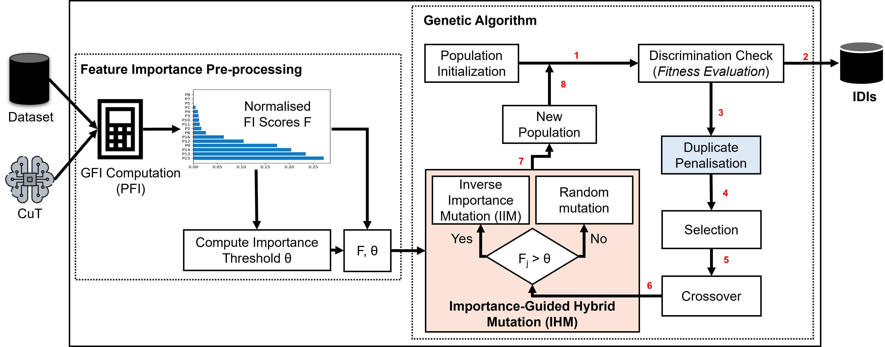

# FIFT: Feature Importance-Guided Fairness Testing for Machine Learning Software



Fig. 1: The FIFT Framework. Feature importance scores are computed and normalised in a pre-processing stage, and an importance threshold θ is derived. The scores and threshold are passed to the genetic algorithm, which alternates between selection, crossover, and IHM-guided mutation. At each generation the fitness evaluation applies a discrimination check with duplicate penalisation.

## Table of Contents

- [Abstract](#abstract)
- [Installation](#installation)
- [Project Structure](#project-structure)
- [Datasets and Protected Attributes](#datasets-and-protected-attributes)
- [Running Fairness Testing](#running-fairness-testing)
  - [Command-Line Arguments](#command-line-arguments)
  - [Running FIFT Directly](#running-fift-directly)
  - [Running Baseline Approaches](#running-baseline-approaches)
  - [Running All Experiments via main.py](#running-all-experiments-via-mainpy)
- [Supported Approaches](#supported-approaches)
- [Feature Importance Methods](#feature-importance-methods)
- [Mutation Operators](#mutation-operators)
- [License](#license)

---

## Abstract

Fairness in machine learning (ML) is a critical software quality concern in high-stakes domains such as healthcare, hiring, and criminal justice, where biased predictions based on protected attributes can cause significant harm. Individual fairness testing (IFT) searches for pairs of inputs — known as individual discriminatory instances (IDIs) — that differ only in a protected attribute, yet yield different classifier predictions, indicating discrimination. While existing search-based methods have been widely employed for IFT, they suffer from three key limitations: (1) random feature perturbation that ignores the varying discriminatory influence of features, (2) reliance on computationally expensive per-instance local explanations, and (3) high test redundancy that wastes computational resources.

This study introduces FIFT (Feature Importance-Guided Fairness Testing), an evolutionary approach that computes global feature importance once via permutation feature importance and uses the normalised scores to guide the search for IDIs. The approach is grounded in the observation that influential features are more likely to lie near fairness-relevant decision boundaries. Accordingly, FIFT introduces Importance-Guided Hybrid Mutation (IHM), which scales perturbation magnitude inversely to feature importance for influential features while applying random perturbations to less influential ones, thus balancing exploitation and exploration of the input space.

Experiments on five benchmark datasets and four ML classifiers show that FIFT detects 20.8%–190.4% more IDIs than the strongest baseline, achieves 2.37×–3.1× higher throughput than local-explanation-based methods, and reduces test redundancy by 84.0%–98.0% relative to other search-based approaches. Retraining with discovered IDIs improves fairness by 28.6%–88.0% with negligible accuracy loss. By integrating global explainability as an active search signal rather than a post-hoc diagnostic, FIFT constitutes a more efficient and effective approach to fairness-aware ML testing

---

## Installation

1. **Clone the repository:**

   ```bash
   git clone https://anonymous.4open.science/r/FIFT/
   cd FIFT
   ```

2. **Create a virtual environment** *(recommended)*:

   ```bash
   python -m venv venv
   source venv/bin/activate       # Linux / macOS
   venv\Scripts\activate          # Windows
   ```

3. **Install dependencies:**

   ```bash
   pip install -r requirements.txt
   ```

---

## Project Structure

```text
FIFT/
├── fift_tutorial/
│   ├── fift_orignal.py                # FIFT entry point and main class
│   ├── ga_orignal.py                  # IHMGA: Importance-Guided Hybrid Mutation Genetic Algorithm
│   ├── compute_feature_importance.py  # Feature importance methods (PFI, SHAP, surrogate)
│   └── generation_utilities.py        # Seed generation and clustering utilities
├── baseline/                          # Baseline fairness testing approaches
│   ├── aft/                           # Abstract Fairness Testing
│   ├── eidig/                         # EIDIG
│   ├── expga/                         # ExpGA
│   ├── grft/                          # GRFT
│   └── maft/                          # MAFT
├── datasets/                          # Raw dataset files
├── preprocessing/                     # Per-dataset preprocessing scripts
├── models/                            # Pre-trained classifiers (LR, DT, RF, DNN) per dataset
├── clusters/                          # Pre-computed K-Means cluster data per dataset
├── utils/                             # Dataset configuration, model wrapper, helper functions
├── img/                               # Framework diagram
├── main.py                            # Batch experiment runner across all approaches
└── requirements.txt
```

---

## Datasets and Protected Attributes

> **Note:** Dataset and protected attribute names are **case-sensitive**.

| Dataset  | Source                                  | Protected Attribute | Index (1-based) |
|----------|-----------------------------------------|---------------------|-----------------|
| `census` | UCI Adult / Census Income               | `age`               | 1               |
|          |                                         | `race`              | 8               |
|          |                                         | `sex`               | 9               |
| `credit` | UCI German Credit                       | `sex`               | 9               |
|          |                                         | `age`               | 13              |
| `bank`   | UCI Bank Marketing                      | `age`               | 1               |
|          |                                         | `marital`           | 3               |
| `compas` | ProPublica COMPAS Recidivism            | `sex`               | 1               |
|          |                                         | `age`               | 2               |
|          |                                         | `race`              | 3               |
| `meps`   | Medical Expenditure Panel Survey (MEPS) | `sex`               | 3               |

Each dataset has pre-trained models for four classifier types: Logistic Regression (`lr`), Decision Tree (`dt`), Random Forest (`rf`), and a Multilayer Perceptron referred to as `dnn`.

---

## Running Fairness Testing

### Command-Line Arguments

All scripts share a common set of arguments:

| Argument             | Type    | Default   | Description                                               |
|----------------------|---------|-----------|-----------------------------------------------------------|
| `--dataset_name`     | string  | `census`  | Name of the dataset to use.                               |
| `--sensitive_name`   | string  | `age`     | Protected attribute to test (`sex`, `age`, `race`, etc.). |
| `--classifier_name`  | string  | `dt`      | Classifier to test (`lr`, `dt`, `rf`, `dnn`).             |
| `--max_allowed_time` | integer | `3600`    | Time budget in seconds.                                   |

---

### Running FIFT Directly

```bash
python ./fift_tutorial/fift_orignal.py \
  --classifier_name dt \
  --dataset_name bank \
  --sensitive_name age \
  --max_allowed_time 3600
```

### Running Baseline Approaches

Each baseline can be executed from its own module. The interface is identical to FIFT:

```bash
# ExpGA
python ./baseline/expga/expga.py \
  --classifier_name dt \
  --dataset_name census \
  --sensitive_name sex \
  --max_allowed_time 3600

# EIDIG
python ./baseline/eidig/eidig.py \
  --classifier_name dnn \
  --dataset_name compas \
  --sensitive_name race \
  --max_allowed_time 3600
```

### Running All Experiments via main.py

`main.py` runs a specified approach across all five datasets, all four classifiers, and all protected attributes for a configurable number of independent iterations.

```bash
python main.py \
  --approach_name fift \
  --max_allowed_time 3600 \
  --max_iteration 5
```

**Available values for `--approach_name`:** `fift`, `aft`, `expga`, `eidig`, `maft`, `grft`

---

## Supported Approaches

| Approach | Description                                             |
|----------|---------------------------------------------------------|
| `fift`   | Feature Importance-Guided Fairness Testing (this work)  |
| `expga`  | Explainability-Guided Genetic Algorithm                 |
| `eidig`  | Efficient Individual Discriminatory Instance Generation |
| `maft`   | Mutation-based Adaptive Fairness Testing                |
| `aft`    | Abstract Fairness Testing                               |
| `grft`   | Gradient-Guided Fairness Testing                        |

---

## Feature Importance Methods

Feature importance is computed once before search begins and passed to the genetic algorithm. The method is specified via the `fi_method` parameter in the `FIFT` constructor.

| Method           | Description                                                            |
|------------------|------------------------------------------------------------------------|
| `permutation`    | Permutation Feature Importance (PFI): accuracy drop on feature shuffle |
| `shap`           | SHAP values via TreeExplainer, DeepExplainer, or KernelExplainer       |
| `surrogate`      | Feature importances from a decision tree surrogate on model outputs    |
| `surrogate_shap` | SHAP values over a surrogate tree fitted on distribution-sampled seeds |
| `uniform`        | Equal feature weights; reduces FIFT to a standard genetic algorithm    |

---

## Mutation Operators

The `IHMGA` class supports three mutation strategies, selectable via the `mutation_type` parameter:

| Operator | Description                                                                           |
|----------|---------------------------------------------------------------------------------------|
| `ihm`    | Hybrid mutation: IIM on features above θ; uniform reset on features below θ (default) |
| `iim`    | Inverse-importance mutation: magnitude α(1 − Ij)Rj, decreasing with importance        |
| `dim`    | Direct-importance mutation: magnitude α·Ij·Rj, increasing with importance             |

The importance threshold θ, which determines the IHM switching point, is configurable via `fi_threshold_type`:

| Value           | Threshold definition                                     |
|-----------------|----------------------------------------------------------|
| `25_percentile` | 25th percentile of the importance distribution (default) |
| `50_percentile` | Median of the importance distribution                    |
| `75_percentile` | 75th percentile of the importance distribution           |
| `mean`          | Mean of the importance distribution                      |
| `std`           | Standard deviation of the importance distribution        |
| `simple`        | Fixed threshold of 0.05                                  |

---

## License

This project is released for research and reproducibility purposes.
